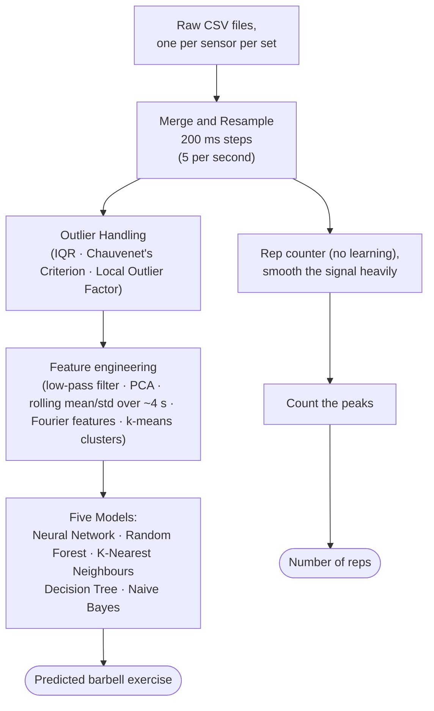

# Introducing Proprio

*Part 0 of a build-in-public series: turning a machine learning research project into a real smartwatch product.*

---

## Where this started

This project builds on a study by Dave Ebbelaar, written for his master's project at the Vrije Universiteit Amsterdam [1]. It asked a question I really liked: could a sensor on your wrist do part of a personal trainer's job? Using data from five people lifting in a real gym, he built a pipeline that works out two things:

1. **which barbell exercise you're doing:** bench press, squat, deadlift, overhead press, or barbell row, or whether you're just resting;
2. **how many reps you did.**

The first results looked great: a random forest scored **98.51%** on sets it hadn't trained on. But the report didn't stop there. When the model was tested on a person it had never seen, accuracy dropped to **85.43%**, and the author concluded that "the models have some problems generalizing to new data" [1].

That sentence is where Proprio starts. A product only matters for people the model has never seen. I wanted to actually wear this thing, on my own watch, in my own gym, and eventually ship it as a real product. This series is the story of that journey, from the original pipeline to the finished product.

I built the pipeline myself, following the YouTube series Ebbelaar later made from the project [2]. My best model scored **99.9% accuracy**. That's higher than anything in the original report, on the same data, and it made me suspicious rather than happy. A number that good deserves a hard second look before I build anything on top of it. That gives me my first question:

> **Question 1:** How accurate is the original pipeline on people it has never seen, when tested fairly?

Two more questions come up along the way.

In this part, I'll walk you through the original study and how its pipeline works, the gaps between a study and a product, who actually needs a product like this, and the roadmap.

## The original work

Before going any further, I want to give proper credit, because the original pipeline stands on a few layers of earlier work.

Ebbelaar collected the data himself, during real gym workouts, for his master's assignment at the Vrije Universiteit Amsterdam [1]:

- **Participants:** five people (himself included), wearing a **MetaMotion** wristband sensor from MbientLab [4].
- **Exercises:** the five lifts from the *Starting Strength* program.
- **Sets:** heavy sets of about 5 reps and medium sets of about 10.
- **Weights:** chosen relative to each person's estimated one-rep max.
- **Rest:** some resting periods were recorded too.

In its own words, the study set out to explore whether context-aware applications could "just like human personal trainers, track exercises, count repetitions, and detect improper form."

The original pipeline follows the course *Machine Learning for the Quantified Self* by Mark Hoogendoorn, and the book of the same name by Hoogendoorn and Funk [3]. A few of its helper modules come straight from the book's public code (ML4QS). Ebbelaar later walked through the whole pipeline in an eight-part YouTube series [2], which is how I built my own version.

The report tested its models three ways, and the harder the test, the lower the number:

- training on the first two sets of each exercise and testing on the rest: **98.51%** with a random forest;
- training on heavy sets and testing on medium sets (and the other way round): about 80%;
- leaving one participant out at a time and testing on them: **85.43%** on average [1].

So here's the honest starting point: a thoughtful study that was upfront about its limits, and two numbers that just don't fit together. The original report got 85% on people the model had never seen. My version of the same pipeline got 99.9%.

## How the original pipeline works

*If you're only here for the product story, feel free to skip ahead to "From study to product".*

Here's the whole pipeline, from raw files to a predicted exercise:

*Figure 1. The original pipeline, end to end. The rep counter works on the resampled data, separately from the models.*

In plain words: the sensor files get merged and put on a common clock of five readings per second, and the obvious glitches are removed. Each moment is then described by a set of **features**, which are just numbers that summarize the last few seconds of motion, like the average acceleration or how rhythmically the signal repeats. Five classic models learn to map those features to an exercise. Separately, a rep counter (no learning involved at all) smooths the signal and counts the peaks.

Every step here is pretty standard for a course project. But keep two details in the back of your head, because they'll matter later. Neighbouring rows share most of their data, since each one summarizes nearly the same few seconds. And the "correct" rep counts come from the set type (heavy = 5, medium = 10), not from anyone actually counting. I'll come back to both in Part 1.

## From study to product

A study is designed to answer a question. A product has to survive real people using it. And between those two, there's a long list of gaps:

- **A different sensor.** Nobody's buying a MetaMotion research band to go lift weights. People wear smartwatches, which come with different units, rates, axes and fit on the wrist. Part 1 gets into what that means for the data.
- **New people.** A product only matters for people the model has never seen before. The original report already found that results drop when the test person is new [1].
- **New conditions.** Different gyms, bars and grips. Walking between sets. Checking your phone mid-workout. All of it ends up in the data.
- **An unchecked number.** My 99.9% came out of one evaluation, run once. Before I trust it, I want to know exactly how the training and test data were split, and whether anything about the test made it easier than real life.

That last one is the first job, and it's exactly question 1. If the number doesn't hold up, everything I build on top of it inherits the problem.

But even if it does hold up, the first gap is still there. A model that only works on the sensor it was trained on can't become a product, which raises the second question:

> **Question 2:** Can a model trained on research-sensor data work on a consumer smartwatch, once units, axes and sampling rates are converted?

## Who actually needs this

Before putting months into this, I had to ask myself who would actually need it. I started out wanting a rep counter for lifters like me. Turns out, that already exists in several forms. What I couldn't find was a way for a physiotherapist or a coach to know whether the exercises they prescribed actually happened.

### Lifters already have options, and they're frustrating

Automatic exercise and rep tracking already ships, or at least is attempted, on Galaxy Watch, Apple Watch and Garmin watches, in WHOOP's strength trainer [11], and in dedicated apps like Motra [12]. And yet users still complain that the rep counts are unreliable [9][10].

So "recognize the exercise and count the reps" isn't, on its own, a good enough reason for Proprio to exist. It's still the foundation everything else needs though, and it's worth getting right.

### The unsolved problem: did the prescribed exercise actually happen?

The more interesting gap is **unsupervised, prescribed strength work**: the exercises a physiotherapist or coach tells you to do at home.

- **Non-adherence is common.** A 2021 paper sums up earlier research: "patient non-adherence with rehabilitation programs is 50%-70%" [5].
- **Self-reports overstate it.** In a 2018 study, people with knee pain kept an exercise diary while an accelerometer hidden in their ankle weight counted what they actually did. The diaries recorded a median of **220** exercises; the hidden sensor counted **176** [6]. Nobody was lying badly, but the diaries were consistently optimistic.
- **Clinicians lack tools.** A 2023 survey of 149 clinicians found that the most common barrier to measuring adherence was simply not having a tool to do it [7].
- **The approach works in research.** Researchers in Toronto (Sunnybrook and the Holland Centre) showed that smartwatch inertial data could recognize shoulder physiotherapy exercises [13]. They then designed a study where data labelled in the clinic is used to classify patients' home sessions [14]. Wrist accelerometers also show up as adherence measures in clinical trials [8].

*Figure 2. Diaries overstate what people actually do. Data from Nicolson et al. (2018) [6]; the accelerometer was hidden in an ankle weight.*

### Wrists can measure more than reps

In a 2023 study, a wrist-worn Apple Watch estimated mean barbell squat velocity about as well as sensors mounted on the bar [15]. There's early work on estimating effort too, though only as a preprint so far [17]. Reviews of commercial training sensors also warn that validation is often weak [16], which is a good reason to measure things carefully instead of trusting the marketing.

And that's the opening. Research has shown the idea works, but there's no product a clinician can just go and buy. That's the gap Proprio is built around, and it leads to the third question:

> **Question 3:** Can a wrist-worn watch verify prescribed home exercise (sets, reps, rest) well enough for a clinician or coach to rely on it?

## Meet Proprio

**Proprio** (short for *proprioception*, your body's sense of its own position and movement) is my attempt at turning that study into something real. It's for lifters, and for the clinicians and coaches who prescribe their training. It has five parts:

- **A smartwatch** records the raw motion of your whole workout, worn on the left wrist.
- **A mobile app** lets you label sets, fix mistakes, and see your history.
- **Backend services** store the raw recordings, convert them, recognize exercises, count reps, and send the results back to your phone.
- **A web app for clinicians and trainers** lets them prescribe exercises and see what their clients actually did, only with the client's consent.
- **An AI coach** explains your training in plain language, based on your own recorded history instead of generic advice.

I'm starting with a Galaxy Watch and an Android phone, simply because that's the watch I have to test on. An Apple Watch and iPhone app will come once the Android product is done. And since the raw recordings get converted on the server, supporting a new watch mostly means describing its sensor (units, axes, rates) and running a calibration session, not training a new model. That's the bet behind question 2.

Two principles run through all of it:

1. **Keep the raw data.** The watch records exactly what its sensors measured, unconverted. Every conversion happens later, in one shared piece of code, so if it turns out to be wrong, it can be fixed and re-run.
2. **Measure before claiming.** Every accuracy number in this series will come from a test designed to look like real use, with its limitations stated right next to it.

## The roadmap

The work comes in three stages, and each phase will get at least one part. Stage 1 answers the first two questions (Phase 0 is question 1, Phases 1–3 are question 2), and Stage 2 is where question 3 gets answered.

### Stage 1: prove it works (Phases 0–5)

| Phase | Goal, in plain words |
|---|---|
| 0 | **Check the baseline honestly.** Make my implementation of the original pipeline reproducible, rerun it, and find out whether 99.9% survives a fair test. |
| 1 | **Teach it to read another sensor.** One standard format that any device's data is converted into before a model sees it, and a simulated watch to test that. |
| 2 | **Build the recorder.** A Galaxy Watch app and a phone app that record a whole workout with clearly marked sets. |
| 3 | **Calibrate and test on real gym data.** Check the watch's units and axes physically, record real sessions, and judge the model against pass/fail rules written in advance. |
| 4 | **Better models.** A small deep-learning model and a reworked rep counter, if the classic models fall short on the watch. |
| 5 | **Services.** A backend that receives recordings from the phone, analyzes them, and returns results reliably. |

### Stage 2: make it useful (Phases 6–9)

This is my answer to "who actually needs this?": the things a wrist-worn strength tracker can do that the crowded market doesn't.

| Phase | Goal, in plain words |
|---|---|
| 6 | **Prescription adherence ledger.** A clinician or coach prescribes exercises on the web app and records a short demo of each on the client's watch. At home, the system detects the sets, matches them to the prescription and shows both sides a weekly ledger of done vs prescribed. |
| 7 | **Wrist velocity-loss feedback** (the riskiest feature). Estimate how much the lift slows down within a set, from the wrist alone, and buzz at a chosen point. It must never claim to tell you how close you are to failure. |
| 8 | **A verified session record for remote trainers.** Online coaching shows what clients *say* they did. Trainers see what the watch saw instead: "logged 4 sets, watch saw 2". |
| 9 | **Tempo and time-under-tension compliance.** Split each rep into its lifting and lowering phases and compare them with a prescribed tempo, as used in tendon rehab. After the session first, real-time buzzes later. |

### Stage 3: grow it (Phases 10–13)

| Phase | Goal, in plain words |
|---|---|
| 10 | **The coach.** A language model (IBM Granite) that answers questions about your training and cites where each answer came from. |
| 11 | **Ship it.** Automated testing, a security review, and deployment to the cloud. |
| 12 | **Personalization.** Use each user's corrections to improve the model for that user. |
| 13 | **Apple Watch and iPhone.** The same product on Apple hardware, once the Android version is done. |

## Doing this responsibly

Phases 6 and 8 bring Proprio pretty close to healthcare. That comes with rules on medical software and health data, in Canada [18] and in the US [19], and it's exactly why they come after a foundation that's been shown to work. A few rules are fixed from the start:

- **Consent.** A clinician or trainer only sees a client's data if the client shares it, and the client can take that access back at any time.
- **No overclaiming.** Velocity-loss feedback is validated against a reference before any cue reaches a user, and it's never presented as telling you how close you are to failure.
- **Grounded AI.** Any AI summary may only restate facts the system computed, and must point to the sessions they came from.

## What I don't know yet

- **No results yet.** Everything in this part is a plan. The numbers come in later parts, including the ones that don't go my way.
- **A small dataset.** The original data comes from five people, all doing the same five lifts. That's enough to learn from, but not enough to prove a product works for everyone.
- **One platform and one wrist to start.** Proprio starts on Galaxy Watch and Android, worn on the left wrist. Other watches, and the other wrist, need their own testing.

## What's next

The first job is the one I started with. The original report got 85% on people the model had never seen. My version of the same pipeline got 99.9% from the same data. They can't both be describing the same reality.

So in Part 1, I'm taking my implementation apart, making it reproducible, and finding out which number to believe.

I'll be writing one part per phase as I build it, and that includes the things that fail. If you're working on something similar, or just curious how a research project actually turns into a product, follow along!

## References

1. Ebbelaar, D. *Exploring the Possibilities of Context-Aware Applications for Strength Training.* Mini Master Project, Vrije Universiteit Amsterdam. (Linked from the tutorial's source material.)
2. Ebbelaar, D. *Full Machine Learning Project — Coding a Fitness Tracker with Python* (video series, 8 parts). https://youtube.com/playlist?list=PL-Y17yukoyy0sT2hoSQxn1TdV0J7-MX4K
3. Hoogendoorn, M. & Funk, B. (2018). *Machine Learning for the Quantified Self: On the Art of Learning from Sensory Data.* Springer. https://link.springer.com/book/10.1007/978-3-319-66308-1 · Code: https://github.com/mhoogen/ML4QS/
4. MbientLab. MetaMotion sensor. https://mbientlab.com/metamotions/
5. Picha, K. et al. (2021). Physical therapists' assessment of patient self-efficacy for home exercise programs. *International Journal of Sports Physical Therapy*, 16(1), 184–194. https://doi.org/10.26603/001c.18957 (the 50–70% figure is from the paper's introduction, summarizing earlier studies)
6. Nicolson, P. J. A. et al. (2018). Self-reported home exercise adherence: a validity and reliability study using concealed accelerometers. *Journal of Orthopaedic & Sports Physical Therapy*, 48(12), 943–950. https://doi.org/10.2519/jospt.2018.8275
7. McArthur, C. et al. (2023). Older adults, clinicians, and researchers' preferences for measuring adherence to resistance and balance exercises. *BMC Geriatrics*, 23, 530. https://doi.org/10.1186/s12877-023-04237-x
8. ClinicalTrials.gov. *Adherence in Upper Extremity Home-based Rehabilitation* (NCT05032638). https://clinicaltrials.gov/study/NCT05032638
9. Samsung Community. "Galaxy Watch 4 Classic rep tracking is not very accurate" (user forum thread). https://eu.community.samsung.com/t5/wearables/galaxy-watch-4-classic-rep-tracking-is-not-a-very-accurate/td-p/4955247
10. TechRadar. "Why Garmin's strength training mode needs to be improved – or scrapped." https://techradar.com/features/why-garmins-strength-training-mode-needs-to-be-improved-or-scrapped
11. the5krunner (2026). "New WHOOP Strength Trainer update: Passive MSK explained." https://the5krunner.com/2026/02/28/new-whoop-strength-trainer-update/
12. Motra (formerly Train Fitness), App Store listing. https://apps.apple.com/us/app/motra-formerly-train-fitness/id1548577496
13. Burns, D. M. et al. (2018). Shoulder physiotherapy exercise recognition: machine learning the inertial signals from a smartwatch. arXiv:1802.01489. https://arxiv.org/abs/1802.01489
14. Burns, D. M. et al. (2020). Adherence tracking with smart watches for shoulder physiotherapy in rotator cuff pathology: protocol for a longitudinal cohort study. *JMIR Research Protocols*, 9(7), e17841. https://doi.org/10.2196/17841
15. Achermann, B. et al. (2023). Velocity-based strength training: the validity and personal monitoring of barbell velocity with the Apple Watch. *Sports*, 11(7), 125. https://www.mdpi.com/2075-4663/11/7/125
16. Weakley, J. et al. (2021). The validity and reliability of commercially available resistance training monitoring devices: a systematic review. *Sports Medicine*, 51, 443–502. https://doi.org/10.1007/s40279-020-01382-w
17. Thomas, J. & Wahlström, J. (2025). Estimation of resistance training RPE using inertial sensors and electromyography. arXiv:2510.03197 (preprint). https://arxiv.org/abs/2510.03197
18. Health Canada (2019). *Guidance Document: Software as a Medical Device (SaMD): Definition and Classification.* https://www.canada.ca/en/health-canada/services/drugs-health-products/medical-devices/application-information/guidance-documents/software-medical-device-guidance-document.html
19. U.S. Food and Drug Administration (2026). *General Wellness: Policy for Low Risk Devices* (updated guidance). https://www.fda.gov/regulatory-information/search-fda-guidance-documents/general-wellness-policy-low-risk-devices
