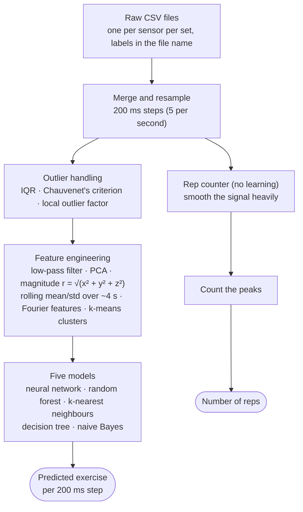

# Introducing Proprio

*An intelligent smartwatch-based fitness tracker.*

---

## 1. Where this started

In 2024 I found a YouTube series by Dave Ebbelaar called **"Full Machine Learning Project — Coding a Fitness Tracker with Python"** [1]. Over eight videos and about seven hours, it builds a program that watches the data from a sensor on your wrist and works out two things:

1. **which barbell exercise you are doing:** bench press, squat, deadlift, overhead press (OHP) or barbell row, or whether you are resting;
2. **how many repetitions you did.**

It is a complete beginner-to-intermediate machine learning project:
- reading raw sensor files;
- cleaning and plotting them;
- removing outliers;
- engineering features;
- training and comparing several models;
- writing a rep counter.

When I got to the end, my best model scored **99.9% accuracy**.

That number is the reason this series exists. A model that is right 999 times out of 1,000 sounds finished. But I wanted to wear it, on my own watch, in my own gym, and I had a nagging feeling that a number that good deserved a hard second look before I built anything on top of it.

This post introduces the project: where the idea and the data come from, how the tutorial pipeline works, why I think it's worth turning into a real product, and the roadmap. It doesn't contain any results yet. Each later post follows the development as it happens.

## 2. The original work behind the tutorial

The tutorial stands on several layers of earlier work, and I want to credit them properly.

- **The dataset and the original study.** Ebbelaar collected the data himself, during real gym workouts, for his masters assignment at the Vrije Universiteit Amsterdam [2]:
  - **Participants:** five people (himself included), wearing a **MetaMotion** wristband sensor from MbientLab [4].
  - **Exercises:** the five lifts from the *Starting Strength* program.
  - **Sets:** heavy sets of about 5 reps and medium sets of about 10.
  - **Weights:** chosen relative to each person's estimated one-rep maximum.
  - **Rest:** some resting periods were recorded too.

  The study's goal was to explore, in its own words, whether context-aware applications could "just like human personal trainers, track exercises, count repetitions, and detect improper form."
- **The method.** The pipeline follows the course *Machine Learning for the Quantified Self* by Mark Hoogendoorn, and the book of the same name by Hoogendoorn and Funk [3]. Several of the helper modules in the tutorial come straight from the book's public code (ML4QS).
- **The report's own results.** The report trained on the first two sets of each exercise and tested on the remaining sets. On that test, a random forest scored **98.51%**. It also tried harder tests, and the numbers dropped:
  - training on heavy sets and testing on medium sets (and the reverse) gave about 80%;
  - leaving one participant out at a time and testing on them averaged **85.43%** [2].

  The author concluded that "the models have some problems generalizing to new data." That sentence turned out to be the most important one for me.

So the honest starting point is this: a thoughtful student project, a clear and well-made tutorial built from it, and my own implementation of that tutorial reporting 99.9%.

## 3. How the original pipeline works

Here is the whole pipeline from raw files to a predicted exercise:

*Figure 1. The tutorial pipeline, end to end. The rep counter works on the resampled data, separately from the models.*

A few ideas in that picture are worth explaining now.

- **Resampling.** The accelerometer and gyroscope tick at different rates. The tutorial puts them on a common clock by averaging everything that falls inside each 200 ms step. Each row of the table becomes one fifth of a second of data.

*Figure 2. Resampling puts the sensors on a common 200 ms clock; a low-pass filter then smooths away jitter (1.3 Hz cutoff, the setting from the original report).*

- **Features.** A single snapshot says very little: one reading could come from almost any exercise. A **feature** is a number computed to describe a short stretch of time, such as "the average y-acceleration over the last 4 seconds" or "how strongly the signal repeats every 2 seconds". Models learn from features rather than from raw snapshots.
- **Windows.** Many features are computed over a **rolling window**: the last few seconds, recomputed every 200 ms. Neighbouring rows therefore share most of their data. The tutorial deals with this by keeping only every other row. I'll come back to overlapping windows in the next post.
- **Models.** Five classic algorithms are compared, then tuned with a grid search (trying many settings and keeping the best).
- **Rep counting.** The rep counter isn't learned at all. It smooths the signal heavily and counts the peaks, with the smoothing tuned per exercise. The "true" rep counts it is compared against come from the set type (heavy = 5, medium = 10), not from someone counting each rep.

*Figure 3. The original rep counter: smooth heavily, then count the peaks. Bench press, participant E. The expected counts come from the set type, not from counting by hand.*

Everything in the pipeline is reasonable and standard for this kind of course project. Whether the final number means what it seems to mean is a separate question, and that's where the next blog begins.

## 4. Why a notebook isn't a product

A tutorial is designed to teach. A product has to survive contact with real people. Between the two there is a long list of gaps:

- **A different sensor.** Nobody buys a MetaMotion research band to lift weights. People wear smartwatches, with different units, rates, axes and fit on the wrist. The next post explains what that means for the data.
- **New people.** A product only matters for people the model has never seen. The original report already found that results fall when the test person is new [2].
- **New conditions.** Different gyms, bars and grips; walking between sets; checking your phone mid-workout. All of this lands in the data.
- **An unchecked number.** My 99.9% came out of one evaluation, run once. Before I trust it, I want to know exactly how the training and test data were separated, and whether anything about the test made it easier than real life.

That last point is the first job. If the number doesn't hold up, everything built on top of it inherits the problem.

## 5. Why it's worth building: the research

Before investing months, I asked whether the world needs another workout tracker.

### The consumer space is crowded, and still frustrating

Automatic exercise and rep tracking already ships, or is attempted, on major platforms such as Galaxy Wear and Apple Watch.

So "recognise the exercise and count the reps" is not, on its own, a reason for Proprio to exist. It is the necessary foundation though, and the competition shows it's still not solved well.

### The unsolved problem: did the prescribed exercise actually happen?

The more interesting gap is **unsupervised, prescribed strength work**: the exercises a physiotherapist or coach tells you to do at home.

- **Non-adherence is common.** A 2021 paper summarises earlier research: "patient non-adherence with rehabilitation programs is 50%-70%" [5].
- **Self-reports overstate it.** In a 2018 study, people with knee pain kept an exercise diary while an accelerometer hidden in their ankle weight counted what they actually did. The diaries recorded a median of **220** exercises; the hidden sensor counted **176** [6]. People didn't lie badly, but the diary was consistently optimistic.

*Figure 4. Diaries overstate what people actually do. Data from Nicolson et al. (2018) [6]; the accelerometer was hidden in an ankle weight.*

- **Clinicians lack tools.** A 2023 survey of 149 clinicians found that the most common barrier to measuring adherence was not having a tool to do it [7].
- **The approach works in research.** Researchers in Toronto (Sunnybrook and the Holland Centre) showed that smartwatch inertial data could recognise shoulder physiotherapy exercises [14]. They then designed a study in which data labelled in the clinic is used to classify patients' home sessions [15]. Wrist accelerometers also appear as adherence measures in clinical trials [8].
- **Wrists can measure more than rep counts.** In a 2023 study, a wrist-worn Apple Watch estimated mean barbell squat velocity about as well as sensors mounted on the bar [16]. There is early work on estimating effort, too, though only as a preprint so far [18]. Reviews of commercial training sensors also warn that validation is often weak [17], which is a good reason to measure carefully rather than trust marketing.

That's the opening: research has shown the idea works, but there's no product a clinician can simply buy. The roadmap at the end of this post comes back to it.

## 6. Meet Proprio

**Proprio** (short for *proprioception*, the body's sense of its own position and movement) is my attempt to turn the tutorial into something real:

- **A Smartwatch** records the raw motion of a whole workout, worn on the left wrist.
- **A mobile app** lets you label sets, fix mistakes, and see your history.
- **Backend services** store the raw recordings, convert them, recognizes exercises, count reps, and send the results back to the phone.
- **An AI coach** explains your training in plain language, grounded in your own recorded history rather than generic advice.

I'm starting with a Galaxy Watch and an Android phone because that's the watch I have to test on. An Apple Watch and iOS mobile app comes after the Android product is done. Because the raw recordings are converted on the server, a new watch mostly needs a description of its sensor (units, axes, rates) and a calibration session, not a new model.

Two principles run through all of it:

1. **Keep the raw data.** The watch records exactly what its sensors measured, unconverted. Every conversion happens later, in one shared piece of code, so it can be fixed and re-run if it turns out to be wrong.
2. **Measure before claiming.** Every accuracy number in this series will come from a test designed to resemble real use, with its limitations stated next to it.

## 7. The roadmap

These are the phases, in order. Each one will produce at least one post. Phases 6–9 are my answer to the question from section 5: what can a wrist-worn strength tracker do that the crowded market doesn't?

| Phase | Goal, in plain words |
|---|---|
| 0 | **Check the baseline honestly.** Make the tutorial code reproducible, rerun it, and find out whether 99.9% survives a fair test. |
| 1 | **Teach it to read another sensor.** One standard format that any device's data is converted into before a model sees it, and a simulated watch to test that. |
| 2 | **Build the recorder.** A Galaxy Watch app and a phone app that record a whole workout with clearly marked sets. |
| 3 | **Calibrate and test on real gym data.** Check the watch's units and axes physically, record real sessions, and judge the model against pass/fail rules written in advance. |
| 4 | **Better models.** A small deep-learning model and a reworked rep counter, if the classic models fall short on the watch. |
| 5 | **Services.** A backend that receives recordings from the phone, analyses them, and returns results reliably. |
| 6 | **Prescription adherence ledger.** On a web app, a physiotherapist, kinesiologist or coach prescribes exercises (sets, reps, rest, tempo, days per week) and records a short demo set of each on the client's watch. At home the client just starts and stops a session; the system detects the sets, matches each to a prescribed exercise (or "unknown"), and counts reps, rest and rep duration. Both sides see a weekly ledger of done vs prescribed. Any AI summary may only restate computed facts and must point to the sessions they came from. |
| 7 | **Wrist velocity-loss feedback** (the riskiest feature). Estimate how much the lift slows down within a set, from the wrist alone, and buzz at a chosen point (for example a 20–25% drop), giving lifters some of what a dedicated bar sensor does. It must never claim to tell you how close you are to failure: velocity loss only roughly tracks that. |
| 8 | **A verified session record for remote trainers.** Online coaching platforms show what clients *say* they did. Trainers see the verified record on the web app. This compares a watch-verified record of sets, rest and session length with the logged workout: "logged 4 sets, watch saw 2", or "rest averaged 45 s vs 2 min prescribed". |
| 9 | **Tempo and time-under-tension compliance.** Split each rep into its lifting and lowering phases and compare them with a prescribed tempo, as used in tendon rehab and tempo training. After the session first, real-time buzzes later. |
| 10 | **The coach.** A language model (IBM Granite) that answers questions about your training and cites where each answer came from. |
| 11 | **Ship it.** Automated testing, a security review, and deployment to the cloud. |
| 12 | **Personalisation.** Use each user's corrections to improve the model for that user. |
| 13 | **Apple Watch and iPhone.** The same product on Apple hardware, once the Android version is done. |

Phases 6 and 8 put Proprio close to healthcare. That brings rules on medical software and health data, in Canada [19] and in the US [20], and it's why they come after a foundation that has been shown to work.

## 8. What's next

The first job is the one from section 1. My model scored 99.9%. In the next post I take the tutorial code apart, make it reproducible, and ask a simple question:

**If you give this model a person it has never seen, how often is it right?**

## 9. References

1. Ebbelaar, D. *Full Machine Learning Project — Coding a Fitness Tracker with Python* (video series, 8 parts). https://youtube.com/playlist?list=PL-Y17yukoyy0sT2hoSQxn1TdV0J7-MX4K
2. Ebbelaar, D. *Exploring the Possibilities of Context-Aware Applications for Strength Training.* Mini Master Project, Vrije Universiteit Amsterdam. (Linked from the tutorial's source material.)
3. Hoogendoorn, M. & Funk, B. (2018). *Machine Learning for the Quantified Self: On the Art of Learning from Sensory Data.* Springer. https://link.springer.com/book/10.1007/978-3-319-66308-1 · Code: https://github.com/mhoogen/ML4QS/
4. MbientLab. MetaMotion sensor. https://mbientlab.com/metamotions/
5. Picha, K. et al. (2021). Physical therapists' assessment of patient self-efficacy for home exercise programs. *International Journal of Sports Physical Therapy*, 16(1), 184–194. https://doi.org/10.26603/001c.18957 (the 50–70% figure is from the paper's introduction, summarising earlier studies)
6. Nicolson, P. J. A. et al. (2018). Self-reported home exercise adherence: a validity and reliability study using concealed accelerometers. *Journal of Orthopaedic & Sports Physical Therapy*, 48(12), 943–950. https://doi.org/10.2519/jospt.2018.8275
7. McArthur, C. et al. (2023). Older adults, clinicians, and researchers' preferences for measuring adherence to resistance and balance exercises. *BMC Geriatrics*, 23, 530. https://doi.org/10.1186/s12877-023-04237-x
8. ClinicalTrials.gov. *Adherence in Upper Extremity Home-based Rehabilitation* (NCT05032638). https://clinicaltrials.gov/study/NCT05032638
9. Ziegler, W. F. et al. (2023). Repetition count concurrent validity of various Garmin wrist watches during light circuit resistance training. *International Journal of Exercise Science: Conference Proceedings*, 14(3) (conference abstract). https://digitalcommons.wku.edu/ijesab/vol14/iss3/143
10. Samsung Community. "Galaxy Watch 4 Classic rep tracking is not very accurate" (user forum thread). https://eu.community.samsung.com/t5/wearables/galaxy-watch-4-classic-rep-tracking-is-not-a-very-accurate/td-p/4955247
11. TechRadar. "Why Garmin's strength training mode needs to be improved – or scrapped." https://techradar.com/features/why-garmins-strength-training-mode-needs-to-be-improved-or-scrapped
12. the5krunner (2026). "New WHOOP Strength Trainer update: Passive MSK explained." https://the5krunner.com/2026/02/28/new-whoop-strength-trainer-update/
13. Motra (formerly Train Fitness), App Store listing. https://apps.apple.com/us/app/motra-formerly-train-fitness/id1548577496
14. Burns, D. M. et al. (2018). Shoulder physiotherapy exercise recognition: machine learning the inertial signals from a smartwatch. arXiv:1802.01489. https://arxiv.org/abs/1802.01489
15. Burns, D. M. et al. (2020). Adherence tracking with smart watches for shoulder physiotherapy in rotator cuff pathology: protocol for a longitudinal cohort study. *JMIR Research Protocols*, 9(7), e17841. https://doi.org/10.2196/17841
16. Achermann, B. et al. (2023). Velocity-based strength training: the validity and personal monitoring of barbell velocity with the Apple Watch. *Sports*, 11(7), 125. https://www.mdpi.com/2075-4663/11/7/125
17. Weakley, J. et al. (2021). The validity and reliability of commercially available resistance training monitoring devices: a systematic review. *Sports Medicine*, 51, 443–502. https://doi.org/10.1007/s40279-020-01382-w
18. Thomas, J. & Wahlström, J. (2025). Estimation of resistance training RPE using inertial sensors and electromyography. arXiv:2510.03197 (preprint). https://arxiv.org/abs/2510.03197
19. Health Canada (2019). *Guidance Document: Software as a Medical Device (SaMD): Definition and Classification.* https://www.canada.ca/en/health-canada/services/drugs-health-products/medical-devices/application-information/guidance-documents/software-medical-device-guidance-document.html
20. U.S. Food and Drug Administration (2026). *General Wellness: Policy for Low Risk Devices* (updated guidance).
